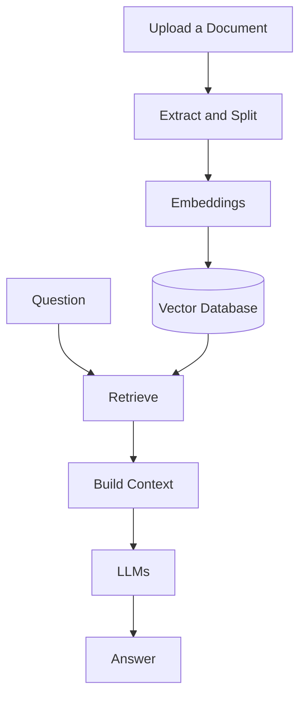

# RAG Chatbot

A local document-based chatbot that allows users to upload documents and ask questions about their content. Built with Retrieval-Augmented Generation (RAG), the application retrieves relevant information from uploaded documents to help generate context-based answers with source references.

The project runs locally using Ollama, with a web interface for interacting with documents and a FastAPI backend.

## Features

- **Document Upload:** Upload documents directly through the web interface.
- **Document-Based Q&A:** Ask questions about uploaded documents and receive answers based on their content.
- **Source References:** View relevant document excerpts and source information alongside generated answers.
- **Document Management:** View uploaded documents and delete documents when they are no longer needed.
- **Configurable Retrieval:** Adjust retrieval settings to control how relevant document content is selected.
- **Local Execution:** Run the language model and embedding model locally through Ollama.
- **REST API:** Interact with the chatbot and document management features through FastAPI endpoints.
- **Automated Testing:** Includes unit tests, integration tests, and a GitHub Actions CI workflow.

## How It Works



1. **Upload:** The user uploads a document.
2. **Process:** The application extracts the text and divides it into smaller chunks.
3. **Index:** A local embedding model converts the text into vectors, which are stored in Qdrant.
4. **Retrieve:** When the user asks a question, the application retrieves relevant document chunks.
5. **Generate:** The local language model uses the retrieved information to generate an answer, accompanied by source references.

## Tech Stack

| Technology | Purpose |
|---|---|
| Python | Main programming language |
| FastAPI | Backend and REST API |
| Streamlit | Web user interface |
| Ollama | Running local language and embedding models |
| Qdrant | Storing and searching document vectors |
| Docker Compose | Running the application services |
| Pytest | Unit and integration testing |
| GitHub Actions | Automated testing in CI |

## Prerequisites

Before running the application, make sure the following are installed and available on your machine:

- **Git** — to clone the repository.
- **Python 3.11+** — for the local Python environment and running tests.
- **Docker Desktop** or Docker Engine with Docker Compose.
- **Ollama** — installed and running on the host machine.

Download the models that you want via Ollama, for example:

```powershell
ollama pull qwen2.5:7b
ollama pull qwen3-embedding:0.6b
```

The language model generates answers, while the embedding model converts document text into vectors for retrieval.

> **Note:** The models run on the host machine through Ollama. Docker Compose runs the frontend, backend, and Qdrant services.

## Getting Started

### 1. Clone the Repository

```powershell
git clone git@github.com:lamn26/rag-chatbot.git
cd rag-chatbot
```

### 2. Configure Environment Variables

Create a local `.env` file from the example:

```powershell
Copy-Item .env.example .env
```

The default configuration is:

```dotenv
OLLAMA_BASE_URL=http://host.docker.internal:11434
QDRANT_URL=http://qdrant:6333

LOCAL_LLM_MODEL=qwen2.5:7b
LOCAL_EMBEDDING_MODEL=qwen3-embedding:0.6b
LOCAL_VECTOR_SIZE=1024
```

These settings configure the Ollama connection, Qdrant connection, and local models used by the application.

The provided configuration is intended for Docker Desktop on Windows or another compatible Docker environment. The Ollama URL may need adjustment for other environments.

### 3. Start the Application

Make sure Ollama is running and both required models are available. Then start the application:

```powershell
docker compose up --build -d
```

Check the status of the services:

```powershell
docker compose ps
```

To view logs:

```powershell
docker compose logs -f
```

### 4. Access the Application

Once the services are running, open the following URLs:

| Service | URL |
|---|---|
| Web Interface | http://localhost:8501 |
| FastAPI Documentation | http://localhost:8000/docs |
| API Health Check | http://localhost:8000/health |
| Qdrant Dashboard | http://localhost:6333/dashboard |

### 5. Stop the Application

Stop and remove the application containers:

```powershell
docker compose down
```

To also remove the persistent Qdrant data volume:

```powershell
docker compose down -v
```

## How to Use

1. Open the web interface at http://localhost:8501 and start with a new session.
2. Upload a document through the document upload section.
3. Wait for the application to process and index the document.
4. Enter a question about the document's content.
5. Review the generated answer and its source references.
6. Upload additional documents or manage existing ones through the interface.

## API Documentation

The backend provides REST API endpoints for chatting and managing documents.

| Method | Endpoint | Description |
|---|---|---|
| `GET` | `/health` | Check API availability |
| `POST` | `/api/v1/chat` | Ask a question about uploaded documents |
| `POST` | `/api/v1/documents/upload` | Upload a document |
| `GET` | `/api/v1/documents` | List uploaded documents |
| `GET` | `/api/v1/documents/{document_id}` | Retrieve document details |
| `DELETE` | `/api/v1/documents/{document_id}` | Delete a document |

Interactive request and response documentation is available at:

http://localhost:8000/docs

## Data Storage

- **`data/sessions/`** — stores session-related files managed by the application.
- **Qdrant storage volume** — stores the indexed document vectors used for retrieval.

Documents uploaded through the application are processed through the same application workflow, whether the upload is initiated through the web interface or the API.

## Testing

The project includes unit tests and integration tests.

Run the unit tests:

```powershell
python -m pytest tests/unit -v
```

Run the integration tests:

```powershell
python -m pytest tests/integration -v
```

Run all tests:

```powershell
python -m pytest tests -v
```

The repository also includes a GitHub Actions workflow that automatically runs the test suites on pushes and pull requests.

## Limitations and Future Improvements

The current version focuses on the core document upload and question-answering workflow. Potential improvements include:

- **Hybrid Retrieval:** Combine semantic vector search with keyword-based search.
- **Reranking:** Reorder retrieved content to prioritize the most relevant passages.
- **Query Rewriting:** Improve question retrieval by reformulating user queries when needed.
- **Multi-Session Support:** Improve the interface for creating and managing multiple chat sessions.

These are planned improvements, not features currently implemented in the main workflow.

## License
